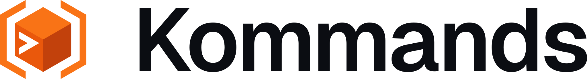
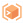

# Kommands mark

The Kommands mark is a block held in brackets, with a prompt cut into its face.
The block is the suite's isometric block, drawn the way Konnekt's and the
Kollektiv mark's are; the brackets are a selector's `[ ]` folded onto the
isometric grid; the prompt says what the app is for, typing commands. Konnekt
is one block with an orbit, Kommands is one block with brackets, and the
Kollektiv mark carries both colours in its bottom layer.

<picture>
  <source media="(prefers-color-scheme: dark)" srcset="lockup-on-dark.svg">
  
</picture>

It replaced the placeholder pixel K on 2026-11-12. The study it was chosen
from, five directions and four rounds on the prompt, is private to the project.

## Files

Every file is an SVG on a transparent background, except the app icons, which
sit on their dark tile. The chevron in the mark files is a mask, so it is real
transparency on any ground.

| File                                                                                                                     | Use                                                           |
| ------------------------------------------------------------------------------------------------------------------------ | ------------------------------------------------------------- |
| [`mark-on-dark.svg`](mark-on-dark.svg), [`mark-on-light.svg`](mark-on-light.svg)                                         | The mark, at 25 px and above                                  |
| [`mark-24-on-dark.svg`](mark-24-on-dark.svg), [`mark-24-on-light.svg`](mark-24-on-light.svg)                             | 17 to 24 px, drawn on a 24 px grid                            |
| [`mark-16-on-dark.svg`](mark-16-on-dark.svg), [`mark-16-on-light.svg`](mark-16-on-light.svg)                             | 16 px and below, drawn on a 16 px grid, without the prompt    |
| [`mark-mono-white.svg`](mark-mono-white.svg), [`mark-mono-black.svg`](mark-mono-black.svg)                               | One colour: the faces are told apart by gaps instead of shade |
| [`lockup-on-dark.svg`](lockup-on-dark.svg), [`lockup-on-light.svg`](lockup-on-light.svg)                                 | Mark and wordmark side by side, the wordmark outlined         |
| [`lockup-stacked-on-dark.svg`](lockup-stacked-on-dark.svg), [`lockup-stacked-on-light.svg`](lockup-stacked-on-light.svg) | Mark above the wordmark, for square slots                     |
| [`wordmark-on-dark.svg`](wordmark-on-dark.svg), [`wordmark-on-light.svg`](wordmark-on-light.svg)                         | The wordmark alone, where the mark already shows nearby       |
| [`app-icon.svg`](app-icon.svg)                                                                                           | The mark at 80 % on a full-bleed `#05060a` square             |
| [`app-icon-16.svg`](app-icon-16.svg)                                                                                     | The 16 cut on the same square, for the 16 px favicon          |
| [`construction.svg`](construction.svg)                                                                                   | The construction below                                        |

The two app icon files are the inputs of `go run ./scripts/gen-appicon`, which
renders `build/appicon.png`, `build/appicon-256.png` and the favicons in
`public/`. They hold only `rect` and `polygon` with every coordinate written
out, no masks or transforms, because that is all the generator reads; the
prompt is painted in the tile's colour rather than cut.

## Construction

Drawn on a 24-unit grid, like Konnekt's, inside the same 21-unit live area
1.5 units in from every edge.

| Part     | Rule                                                                                                                                                                       | Value                                                                                |
| -------- | -------------------------------------------------------------------------------------------------------------------------------------------------------------------------- | ------------------------------------------------------------------------------------ |
| View     | Isometric, the same view as Konnekt's block                                                                                                                                |                                                                                      |
| Block    | An isometric cube at the centre                                                                                                                                            | edge 7.3                                                                             |
| Base     | The faces sit on a hexagon filled with the left face's shade, so the seams between faces never anti-alias against the ground                                               |                                                                                      |
| Brackets | The halves of a hexagon around the block, opened at top and bottom                                                                                                         | radius 10.3, stroke 1.5, each arm running 56 % of the way to the top or bottom point |
| Prompt   | A chevron on the block's left face, its arms on the block's two 30° lines, so on screen they mirror each other at one angle and one width and run parallel to the brackets | stroke 0.18 of the block's edge                                                      |
| Ends     | Every end, the brackets' and the chevron's, is cut vertical like the block's own edges                                                                                     |                                                                                      |

The chevron is fitted to the face, not placed by eye. Its left end sits a
margin _m_ in from the face's outer edge and its tip _m_ from the front edge,
with _m_ = 0.12 of the block's edge. Above the upper arm the margin is 1.3 _m_,
and the foot of the lower arm then clears the bottom edge by 0.7 _m_: with the
arms on the 30° lines the four margins are linked, the bottom one always being
left plus tip minus top. The extra room above is optical. The upper arm runs
parallel to the top edge for its whole length, so an equal margin there reads
tighter than the one at the left, which only meets the chevron's two ends.

## Sizes

The full mark holds down to 25 px. Two sizes are redrawn rather than shrunk,
so their vertical edges fall on whole pixels and stay sharp:

- **24 cut** (17 to 24 px). The block's vertical edges on x = 6, 12 and 18, the
  brackets' stems two pixels wide in columns 2 to 3 and 20 to 21, the chevron
  fitted to the face by the same rule with its left end and tip one pixel in.
- **16 cut** (16 px and below). The block's vertical edges on x = 4, 8 and 12,
  the brackets' stems one pixel wide in columns 1 and 14, and no prompt: at
  this size it would be one-pixel strokes in a four-pixel face.

Sizes are device pixels: a mark laid out at 16 px on a 2× screen takes the
full drawing.

## Colour

Each face takes one of three shades: the lightest on top, the darkest on the
right. The brackets take the top shade. On light grounds everything steps one
shade darker, as Konnekt's mark does.

| Part          | On dark   | On light  |
| ------------- | --------- | --------- |
| Top, brackets | `#fb923c` | `#f97316` |
| Left          | `#f97316` | `#ea580c` |
| Right         | `#ea580c` | `#c2410c` |
| Wordmark      | `#ffffff` | `#0b0d12` |
| App icon tile | `#05060a` |           |

Tailwind's orange 400 to 700, the ladder kollektiv's `design/brand/` gives
Kommands. The top shade is `brand-kommands` in `tokens.source.json`.

## Lockup

The same rules as Konnekt's and Kollektiv's, so the three lockups set side by
side:

- The mark's box is 1.2 times the wordmark's font size, and its centre sits on
  the middle of the cap height.
- The gap between the box and the wordmark is 0.4 times the font size.
- The wordmark is Geist SemiBold at -0.03 em tracking, shaped with its kerning
  and outlined from Geist 1.200 (the npm `geist` package at 1.3.1). Geist is
  © Vercel under the SIL Open Font License 1.1.
- Clear space: at least half the mark's height on every side.
- Minimum sizes: the mark at 16 px with the 16 cut; the lockup at 96 px wide.
  Below that, use the mark alone.

The horizontal lockup file is cropped to its ink and is 0.89 times as tall as
its font size; to set the wordmark at a given size, size the image at 0.89 em.
The stacked lockup puts a mark box of 2.4 times the font size 0.5 times the
font size above the cap line, both centred.

## Do not

- Colour the brackets apart from the block, or put the prompt on another face.
- Add the underscore back: the prompt is the chevron alone.
- Scale the 16 or 24 cut up, or the full mark down past 25 px.
- Add outlines, shadows, gradients or glows.
- Put the coloured mark on a mid-tone or orange ground. Use the app icon tile,
  or a one-colour file.

## Where it is used

- **The desktop app.** `build/appicon.png` (macOS, and the source Wails makes
  the Windows `.ico` from) and `build/appicon-256.png` (the Linux window icon),
  rendered by `go run ./scripts/gen-appicon`.
- **The web app.** `public/favicon-16.png` (the 16 cut), `favicon-32.png` and
  `favicon.png` (256 px, also the Apple touch icon), linked from `index.html`.

The Windows `.ico` is still a downscale of `appicon.png`, so its 16 and 24 px
frames do not use the drawn cuts: Wails writes it at build time and this repo
deliberately does not commit it (see `.gitignore`).
